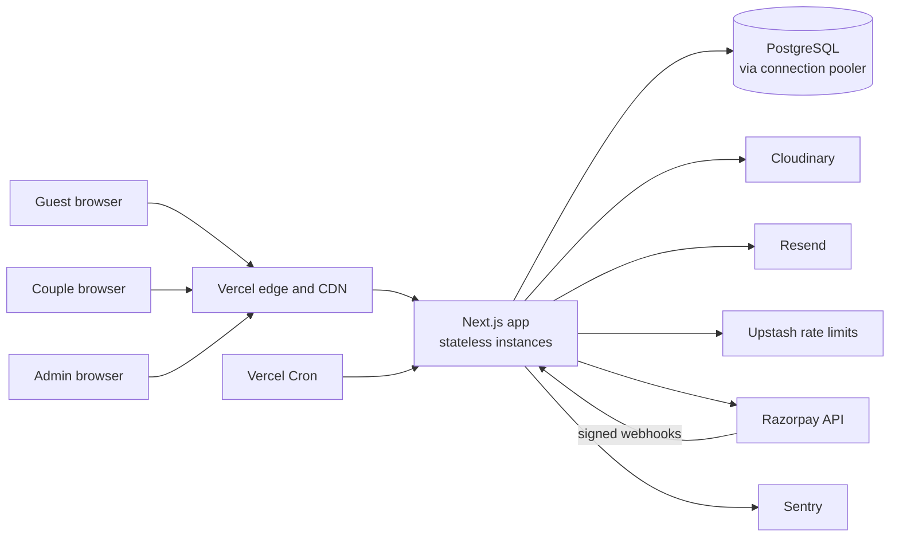
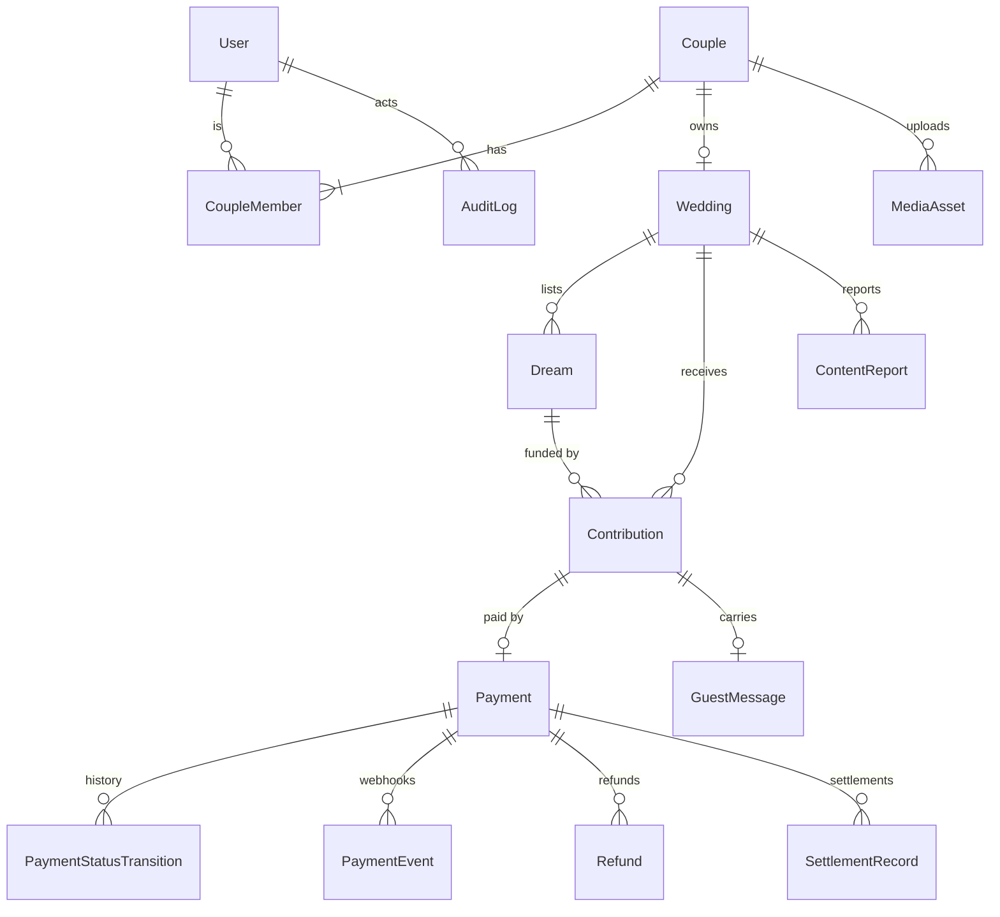
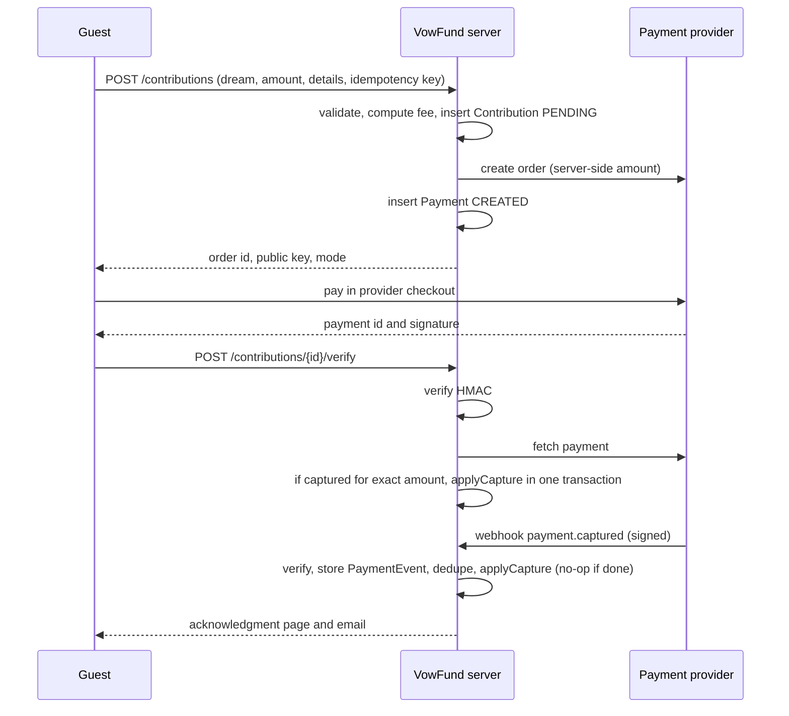

# VowFund Architecture

_Give them memories, not things._

VowFund is a wedding gifting platform for Indian couples. A couple publishes a page of dreams; guests contribute towards them with a personal message. This document describes how the system is built. Decisions with trade-offs are recorded in [docs/adr](docs/adr).

## 1. Guiding constraints

1. **The platform never holds money.** Real payments stay disabled until a provider-approved settlement model exists ([ADR 0003](docs/adr/0003-payment-architecture.md)).
2. **A contribution counts only after the provider confirms capture**, verified on the server.
3. **Guests need no account** and give only a name, an email and an optional message.
4. **The app tier is stateless**, so it scales by adding instances. All state lives in Postgres and object storage.
5. **One deployable.** A modular monolith, not microservices ([ADR 0001](docs/adr/0001-modular-monolith-on-nextjs.md)).

## 2. Stack

Versions are the current stable releases checked on 2026-11-15 and are pinned in Phase 2.

| Concern              | Choice                                                                                    |
| -------------------- | ----------------------------------------------------------------------------------------- |
| Runtime              | Node.js 24                                                                                |
| Framework            | Next.js 16 (App Router), React 19, TypeScript strict                                      |
| Styling and UI       | Tailwind CSS 4, shadcn/ui, Framer Motion (restrained)                                     |
| Forms and validation | React Hook Form, Zod 4                                                                    |
| Database             | PostgreSQL, Prisma 7 (stable line; 8 is still a release candidate)                        |
| Auth                 | Better Auth: magic link and Google ([ADR 0002](docs/adr/0002-authentication.md))          |
| Payments             | Provider interface: Mock and Razorpay                                                     |
| Media                | Cloudinary (signed uploads, re-encoding, CDN)                                             |
| Email                | Resend, through a Postgres outbox ([ADR 0005](docs/adr/0005-async-work-without-redis.md)) |
| Rate limiting        | Upstash Redis over HTTP                                                                   |
| Errors               | Sentry                                                                                    |
| Tests                | Vitest (unit, integration), Playwright (end to end)                                       |
| CI/CD                | GitHub Actions, Vercel                                                                    |

## 3. System overview



## 4. Code structure

```
src/
  app/
    (marketing)/            landing, legal pages
    (auth)/                 sign-in, magic link callback
    (couple)/dashboard/     onboarding, dreams, contributions, messages, settings
    (admin)/admin/          admin console
    wedding/[slug]/         public microsite, dream page, checkout
    gift/[token]/           guest acknowledgment
    api/                    REST endpoints (see docs/API.md)
  modules/
    auth/  couple/  wedding/  dream/  contribution/  payment/
    notification/  media/  admin/  analytics/  audit/
  components/
    ui/                     shadcn primitives
    themes/                 the three wedding themes as token sets
  lib/                      db client, env, errors, logger, http helpers, rate limit
  generated/prisma/         generated client (not committed)
prisma/                     schema and migrations
tests/                      integration and end-to-end tests
docs/                       ADRs, API contracts
```

### Layering rules

```
React component / route handler / server action
        │  parses input with Zod, calls exactly one service function
        ▼
   service            business rules, authorization, transactions
        ▼
   repository         the only layer that imports Prisma
```

- Modules call each other through services only.
- Server Actions are used for couple dashboard forms, where they remove boilerplate. Anything a guest, a webhook or a cron job calls is a REST route.
- Public reads are React Server Components calling services directly.

### Cross-cutting

- **Errors:** services throw typed `AppError` subclasses (`ValidationError`, `NotFoundError`, `ForbiddenError`, `ConflictError`, `RateLimitedError`, `PaymentError`). One handler maps them to the response format. Unknown errors go to Sentry and return a generic 500. Nothing is swallowed.
- **Response format:** `{ "data": ... }` on success, `{ "error": { "code", "message", "fields?" } }` on failure.
- **Logging:** structured JSON with a request id. Emails and payment payloads are redacted.
- **Environment:** parsed once with Zod at boot; a missing or malformed variable fails the build.
- **Audit:** every state change by a couple, an admin, a webhook or a job writes an `AuditLog` row in the same transaction.

## 5. Data model

Full definitions with indexes and deletion rules are in [prisma/schema.prisma](prisma/schema.prisma).



### Relationships that matter

- **User, Couple, CoupleMember.** A couple is the owning entity; users join it through `CoupleMember`. This lets the second partner get their own login later without restructuring.
- **Couple to Wedding is one to one.** There is no separate wishlist table: the wedding's dreams are the wishlist.
- **Contribution holds the guest.** Guests have no account, so name, email and the anonymous flag live on the contribution.
- **Contribution to Payment is one to one.** A retry inside the provider's checkout reuses the same order. A guest who abandons and starts again creates a new contribution with a new idempotency key.
- **PaymentEvent** stores every webhook delivery before processing. `(provider, providerEventId)` is unique, which is what makes duplicate deliveries harmless.
- **PaymentStatusTransition** is append-only and is the audit trail for money.
- **Dream counters** (`fundedPaise`, `contributionCount`) are written only inside the capture and refund transactions ([ADR 0004](docs/adr/0004-funding-totals.md)).
- **Deletion.** Financial rows use `Restrict`. Dreams are soft-deleted with `deletedAt`. A wedding with contributions can be unpublished but not deleted. Sessions, accounts and media cascade from their owner.
- **Changes from the brief's entity list.** `Wishlist`, `Guest`, `Admin` and `WeddingTheme` were folded into `Wedding`, `Contribution`, `User.role` and code. `PaymentStatusTransition`, `AnalyticsEvent`, `ContentReport`, `SupportRequest` and `PlatformConfig` were added.

## 6. Authentication and authorization

- Sessions are database-backed and carried in httpOnly cookies.
- `requireUser()`, `requireCoupleMember(coupleId)` and `requireAdmin()` are called inside service functions, so no route can forget them.
- Middleware redirects unauthenticated visitors away from `/dashboard` and `/admin` for user experience only. It is not the security boundary.
- Cookie-authenticated mutations check the `Origin` header in addition to SameSite cookies. Webhooks are authenticated by signature, cron routes by `CRON_SECRET`.

## 7. Payment flow



`applyCapture` is the single place a contribution becomes real. It is idempotent, so the callback, the webhook and the reconciliation job can all race safely.

Modes, the state machine and the going-live gate are in [ADR 0003](docs/adr/0003-payment-architecture.md).

## 8. Scalability

| Pressure                                            | Design response                                                                                                                            |
| --------------------------------------------------- | ------------------------------------------------------------------------------------------------------------------------------------------ |
| Many guests opening one page after a WhatsApp share | Public pages are server-rendered and cached at the CDN, revalidated by tag (`wedding:{id}`) when a payment is captured or the couple edits |
| Per-page database cost                              | One query for the wedding with its active dreams, using stored counters. No aggregates, no N+1                                             |
| Serverless connection storms                        | Pooled connection string for the app, direct connection only for migrations                                                                |
| Concurrent payments on one dream                    | Atomic increments inside a transaction with a row lock on the payment                                                                      |
| Webhook bursts and retries                          | Insert-first with a unique key; processing is idempotent; failures return 5xx so the provider retries                                      |
| Long lists (contributions, messages, admin tables)  | Keyset pagination on `(createdAt, id)`, never offset                                                                                       |
| Images                                              | Direct browser-to-Cloudinary signed uploads; responsive, re-encoded delivery from its CDN                                                  |
| Email spikes                                        | Outbox with scheduled retry, off the request path                                                                                          |
| Abuse                                               | Rate limits per IP and per wedding on checkout, messages, auth and uploads                                                                 |
| Growth of event tables                              | `AnalyticsEvent` and `PaymentEvent` are indexed by time and can be partitioned or archived later without schema changes elsewhere          |

Never cached publicly: dashboards, acknowledgment pages, anything containing a guest email or payment detail.

## 9. Security and privacy

- Zod validation on every input; Prisma parameterises all queries.
- React escapes guest content; no raw HTML rendering of user text. A strict Content Security Policy allows only our own origin, Cloudinary and Razorpay Checkout.
- Headers: HSTS, `X-Content-Type-Options`, `Referrer-Policy`, frame-ancestors none.
- Uploads: signed upload parameters from the server, allow-list of JPEG, PNG and WebP, 8 MB cap, type confirmed from the file's bytes on Cloudinary's side, metadata stripped on re-encode.
- Public wedding queries select an explicit list of fields. Guest emails never leave the couple dashboard and admin console.
- Anonymous contributions hide the name from other guests. The couple still sees it, and checkout says so.
- Draft and unpublished weddings return 404 publicly. Search indexing is off unless the couple opts in.
- Secrets live only in Vercel environment variables. Rotation steps are documented in the README in Phase 2.
- Card data never touches our servers; the provider's hosted checkout collects it.

## 10. Deployment

| Environment | App                             | Database                                     | Payments                           |
| ----------- | ------------------------------- | -------------------------------------------- | ---------------------------------- |
| Local       | `next dev`                      | Postgres in Docker                           | `mock`                             |
| CI          | GitHub Actions                  | Postgres service container                   | `mock`                             |
| Preview     | Vercel preview per pull request | Database branch                              | `test`                             |
| Production  | Vercel, custom domain, HTTPS    | Managed Postgres with point-in-time recovery | `test` until approval, then `live` |

- CI runs lint, type check, unit tests, integration tests and Playwright before any merge.
- Migrations run with `prisma migrate deploy` as a release step and are written to be backward compatible, so the previous app version keeps working during rollout.
- Rollback is Vercel's instant rollback to the previous deployment.

## 11. Open items needing outside confirmation

- Razorpay's approval of Route for wedding gifting, and the registered entity it requires.
- Tax treatment of gifts and fees, DPDP notices and consent wording, and the refund policy. These need a professional review; nothing in this repository asserts compliance.
